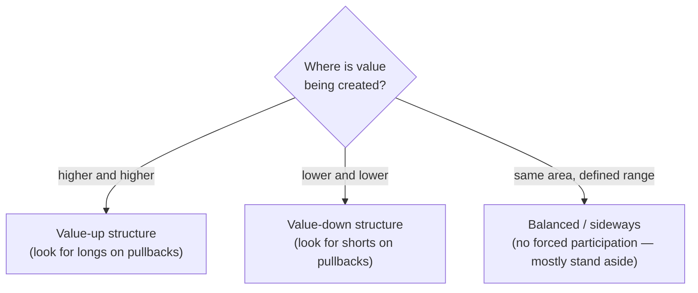
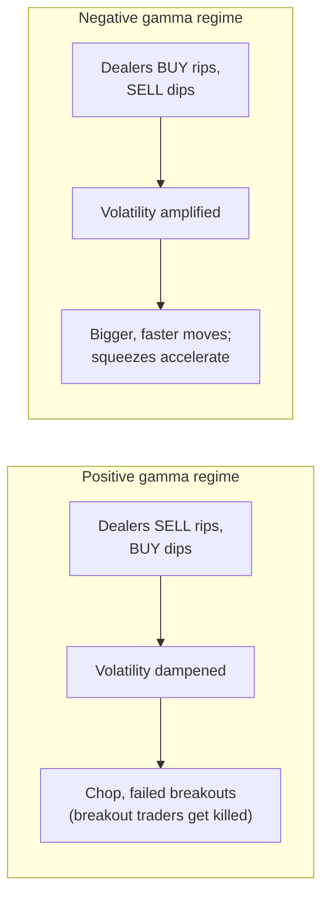

# Step 1 · Environment — "what kind of day am I walking into?"

All of this happens **before the open**. Chris: *"I will never do this while price is
moving a million miles an hour. I need to build my scenarios before the market opens."*

Environment has two components: **market structure** (direction of value) and
**gamma exposure** (volatility regime).

## 1. Higher-timeframe market structure

On the 1-hour / 4-hour chart he classifies the market as one of three states, based on
where *value* is being created (basic structure: higher highs / higher lows, and how
the daily or cash-session volume profiles stack):

The core idea behind everything is the market as an **auction**:

- In balance, buyers and sellers are comfortable; positions are built, nobody is forced to do anything.
- When one side gets aggressive at an edge, the other side's hand is **forced**: a trapped
  buyer must *sell* to exit, a trapped seller must *buy* to exit — fuel for the move against them.
- He wants to trade exactly those moments: an edge attempt that **fails** and leaves
  participants offside. Not home runs — "50 points, 100 points".

## 2. Gamma exposure (GEX)

The options market is enormous, and dealers/market makers hedge in the underlying
(futures). Their mechanical hedging behavior shapes intraday volatility:

Important nuance he calls out: **positive ≠ long, negative ≠ short.** The colors on a
gamma chart say nothing about direction — only about how dealers' hedging will dampen
or amplify moves.

What he marks before the open:

- **Call wall** (major resistance from dealer positioning)
- **Put wall** (major support)
- **Gamma flip zone** — the "line in the sand" where the regime flips between positive
  and negative territory

He uses **naive GEX** (broad-assumption calculations, e.g. the Tanuki Trade platform)
rather than expensive inferred/CBOE-data models, because he doesn't trade bounces off
specific gamma levels — he only needs the *regime*. Proper CBOE-based data exists mostly
for SPX/ES only and costs ~$300/month.

## Output of this step

One sentence that frames the whole session, e.g.:

> "We are in a **value-up structure** in a **negative gamma environment** — so I lean
> long on pullbacks, and if a squeeze starts it can be fast."
