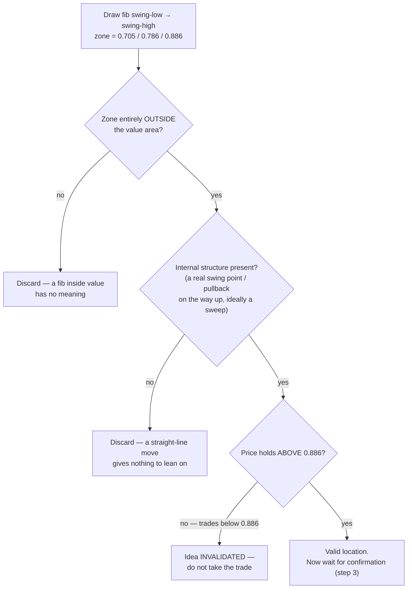

# Step 2 · Location — "where do I want to do business?"

Structure says *what* to look for; location says *where*. Chris does **not** chase a
value-up structure at the highs — *"that's an expensive place to get involved"*. He
waits for price to pull back into **discount**.

## Value area, premium and discount

Using the (daily / cash-session) volume-profile value area as the reference:

- **Inside value area** — buyers and sellers agree; no edge.
- **Above value area** — premium. In an uptrend: don't buy here, and don't short it either
  ("not a good idea to call the top — you'll get run over by continued expansion").
- **Below value area** — discount. In a value-up structure this is where he wants to buy.

A sell-off at the open that breaks below value-area low *into* discount is not a reason
to short — *"you'd be selling the most optimal area to buy."*

## Pinning down the discount zone: Fibonacci

The zone is drawn with a Fibonacci retracement from **swing low to swing high** of the
leg he expects to continue. The levels that matter (a "golden pocket" idea, deep variant):

| Level | Role |
|---|---|
| **0.705** | top of the zone |
| **0.786** | middle |
| **0.886** | the hard edge — beyond this the idea is dead |

## Validity rules for the zone

Not every fib zone is tradeable. Three checks:

Why 0.886 is the line: *"if we're going to come back up, it happens before the 0.886.
The moment sellers push past it, I'm not taking the trade."*

Extra context that strengthens the location:

- The pullback lands in an **inefficient** part of the prior move — an area price moved
  through fast (e.g. an Asia-session push), where little business was transacted.
- That area is a **low volume node (LVN)** on the profile: little acceptance, so price
  tends to reject rather than linger.

## Output of this step

A concrete zone on the chart ("the box") where — and only where — he is willing to
evaluate a long. A box on the chart is still just a drawing, though:
*"just because I draw a box doesn't mean price will respect it."* That is what step 3 is for.
