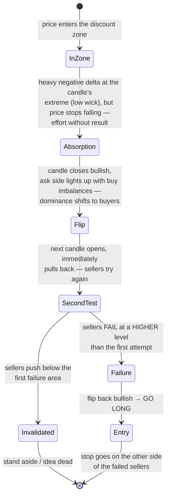
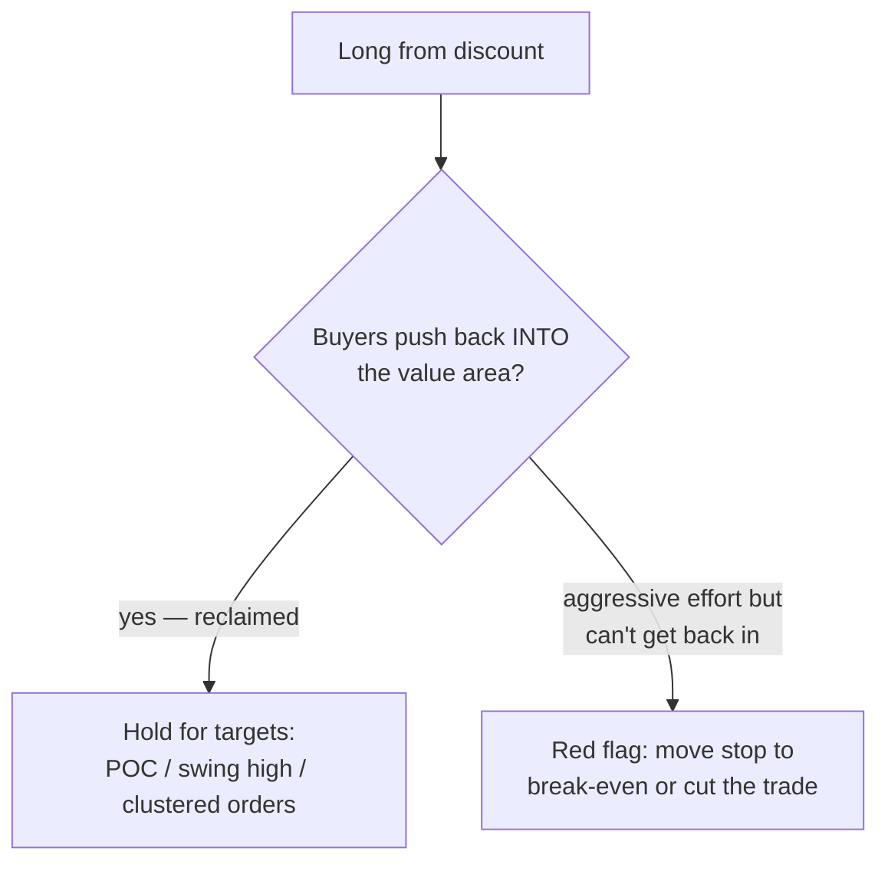

# Step 3 · Confirmation — "is my box actually a level?"

Price is in the zone. Now order flow must prove the trade idea. He watches **5-minute
footprint candles** in two views side by side:

- a candle with a **volume profile** inside it (where in the candle did contracts trade,
  and where is the candle's POC — point of control), and
- a candle with a **delta profile** inside it (aggressive buys minus aggressive sells,
  per price level — "a ladder of delta").

A normal OHLC candle is *"the scoreboard of the auction"* — the footprint shows **how**
the score came about. On the bid×ask ladder: fills on the ask = aggressive buyers,
fills on the bid = aggressive sellers. His chart bolds any level with an
**imbalance of 400% or more**, so one-sided aggression lights up visually.

## What he needs to see: absorption, then a shift of dominance

The sequence, in auction terms: sellers push aggressively into discount (heavy negative
delta at the candle's low), but price stops going down — their **effort gets no result**.
That is **absorption**. Crucially: *"absorption doesn't mean automatic reversal — it
happens constantly."* So he waits for the **dominance to shift** and for sellers to
**fail on a second try, higher up**.

Why the second failure matters: after one flip *"we can be whiplashing around — I want
to see them try again."* One absorption print is noise; two failed attempts, the second
one higher, is trapped sellers.

## The entry and the stop

- **Entry:** the moment the second seller-attempt fails and the candle flips bullish,
  ideally with the ask lighting up (buyers lifting the offer aggressively).
- **Stop loss:** *"on the other side of the failed sellers"* — because the idea is
  invalidated exactly when sellers push past the area they twice failed to break.

The trap mechanism is what powers the move: shorts who entered in discount are now
offside; covering (buying) accelerates the move, and in a **negative gamma** environment
dealers buy into the rip too — squeezes get fast.

## First checkpoint after entry: reclaiming value

The first thing he watches after entry is whether buyers can **reclaim the value area**:

The same effort-versus-result lens applies in reverse: buyers burning aggression while
price stays below value area is the mirror image of the setup itself.
