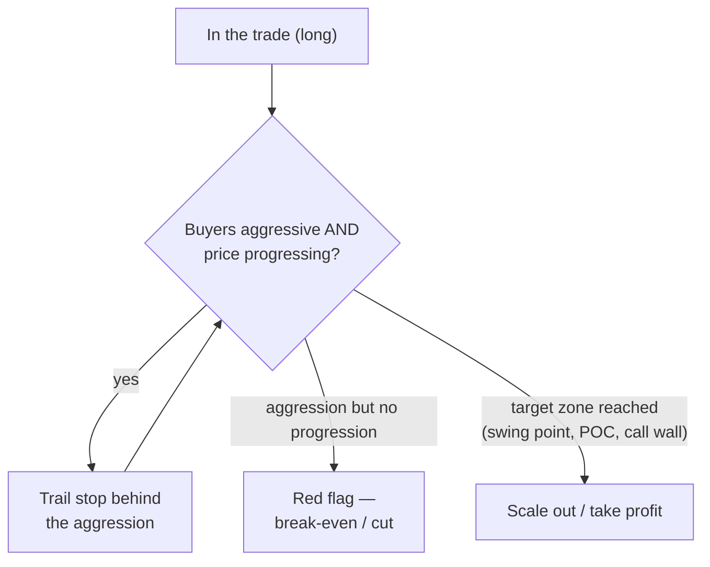
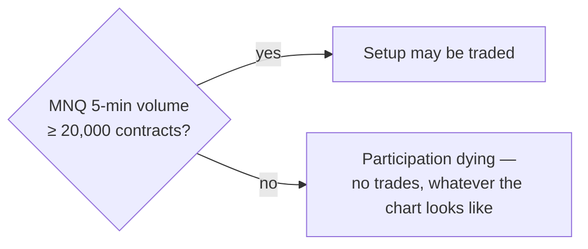

# Step 4 · Trade management — targets, trailing, and the numbers

## Targets

Primary target: **swing points** — *"if the market never takes a swing point, we'd
flatline; the market goes and takes swing points."* Secondary reference points:

- the **POC** of the relevant value area,
- **clustered orders** on the book around psychological levels / swing highs
  (orders there tend to be real and get filled, unlike much of the spoofed book),
- the **call wall** from the gamma map — approaching it he tightens the trail even if
  the full target is further away,
- the bigger picture: in a value-up structure, the market "searching for new value"
  above the old high is the natural magnet.

## Managing the position

While in the trade he keeps reading the footprint candles (bid×ask with volume and
delta): buyer aggression must keep producing **price progression**. Each time effort
gets result, he **trails the stop behind that aggression**. Aggression that stops
getting result → tighten or exit.

## The performance profile

Deliberately *not* a home-run profile:

| Metric | Value (as stated) |
|---|---|
| Typical realized reward | **1.5R – 2R** |
| Win rate | **60–65%** |
| Profit factor | **~1.8** |
| Trades per day | **0–2**, occasionally more |
| Session | first **~90 min** of NY open (sometimes Asia) |

Why small R suits prop firms: a typical 50k account has ~$2,000 drawdown and a $3,000
profit target — the account itself is a 1.5R bet, so consistently banking 1.5R trades
is exactly the game. He'd rather add confirmation that "ruins the bottom tick" and be
right more often than look good with tiny stops: *"I don't want to look cool. I want
to be right."* High-R hunting also breeds long losing streaks that beginners answer
with tilt.

## The participation filter (hard rule)

A trade this dependent on reading aggression needs *participants*:

> **Below ~20,000 contracts per 5-minute MNQ candle → don't touch it.**

Volume tapering off (typically heading into the lunch hour) means the absorption /
trap mechanics stop working. This is also why his trading day is only ~90 minutes:
he watches charts all day, but only *participates* when volume is real.

