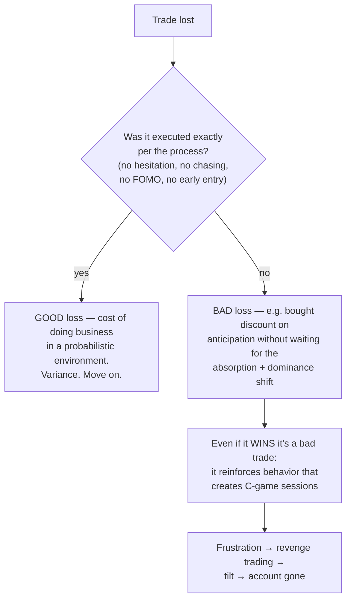
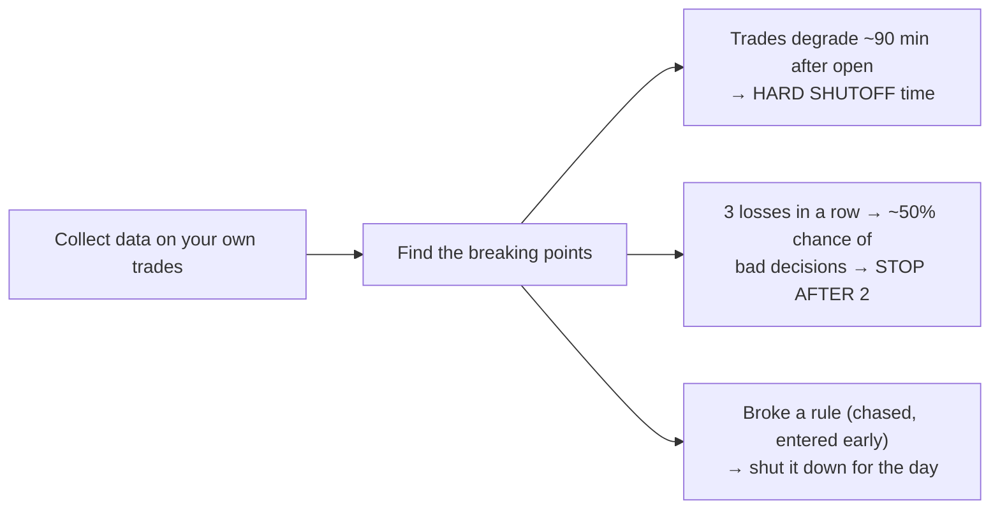

# The other half: discipline, rules and eliminating the C-game

Chris is explicit that the strategy is *not* what made him profitable — the second half
of the interview is about behavior. *"Money is the byproduct of proper execution."*

## A-, B- and C-game sessions

Sessions are graded on **execution quality, not P&L**. His core claim:

> Consistency doesn't come from more A-game sessions — you don't control how many A+
> setups show up. It comes from **eliminating C-game sessions**, the ones that destroy
> a week or a month of good work. Back-end optimization, not front-end.

This is the prop-firm boom/bust loop: pass the eval, get funded, blow the account on
day four — one C-game session.

## Good loss vs bad loss

## Rules must have an action attached

*"Don't overtrade"* and *"don't oversize"* are **not rules** — a rule is specific,
actionable, and personal. Every trader has a **line in the sand** where calculated
decisions become emotional ones; it differs per person (a P&L number, a count of
break-evens or losses, even overconfidence after winning) and it is usually invisible
to the person it's happening to. Diagnose it from data, then build a tripwire *before*
the breaking point:

(The examples are his actual rules. Note the logic of the second one: on a 0–2 trades
per day process, three setups in an hour were probably never three real setups.)

## The turning point (his account of it)

Focused on money → strategy-hopping from YouTube setups → lost savings, into debt.
The reset that worked:

1. **Size down to one micro** — size so small it's "almost insulting", removing money
   from the equation as far as possible.
2. Grade only **execution**, rep after rep, on one single strategy.
3. Pick a strategy that **fits your personality** (a many-setups-per-day scalping style
   suits some people and destroys others), then *don't hop*.
4. Understand the mechanics first — auction market theory, who the participants are,
   what forces them to act — before drawing lines on charts.

His closing advice to struggling traders: most struggling is a **behavior problem, not
an information problem**. If you're struggling: size all the way down for a month and
grade yourself on execution only. And the biggest edge a retail trader has is
**selective participation** — most days the best-informed decision is to not trade.
Order flow, used well, *filters trades out*; used badly, it makes you take more.
