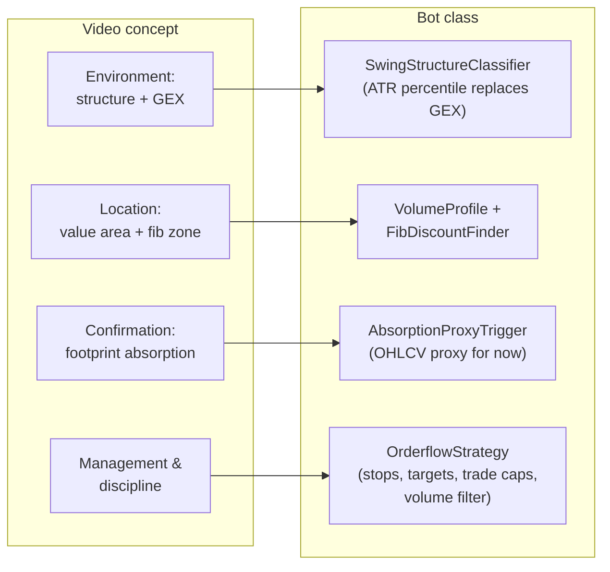

# The crypto adaptation — `nl.debo.cryptodata.bot`

The strategy from this documentation, translated to Bitvavo spot markets as a
**backtest + paper-trading bot**. No real orders are ever placed. Long-only,
1h execution candles with 1d candles for the environment.

## What maps to what

Every step is a small interface (`EnvironmentClassifier`, `LocationFinder`,
`EntryTrigger`), so a piece can be swapped without touching the loop — that is
how the real delta layer gets in later.

## Honest deviations from the video

- **No GEX.** Crypto spot has no options chain; an ATR-percentile volatility
  regime (CALM/EXPLOSIVE) stands in, and only annotates trades.
- **No footprint data (yet).** The absorption + "second failure higher"
  sequence is approximated from candle shapes. This is the weakest link:
  the video's edge lives exactly in this layer.
- **No sessions.** Crypto trades 24/7; the "first 90 minutes of New York"
  becomes a per-candle volume-percentile participation filter.

## Main classes (run from the IDE)

| Class | What it does |
|---|---|
| `OrderflowBacktest` | Runs the strategy over the local candle store; per-market stats + totals. Args: market names, or none for every market. |
| `PaperTradingBot` | Polls fresh Bitvavo candles every hour and logs the entries/exits the strategy would take to `output/bot-paper/paper-trades.csv`. |
| `TradeTapeCollector` | Records the public trade tape (with taker side) to `output/trade-tape/` — the raw material for real per-candle delta (`CandleDelta`). Bitvavo only serves recent trades, so this must run continuously before a delta-based trigger can ever be backtested. |

## First backtest result (2026-09-07, defaults)

Full candle store, 1h execution: **698 trades, 31% win rate, profit factor
0.66, −€257** at €100 stake / 0.25% fee per side. Majors only (BTC, ETH, SOL,
XRP, ADA): 84 trades, PF 1.10, ≈ break-even.

That is the expected shape of a v1: the candle proxy captures the *location*
logic but not the *confirmation* edge, and the video's own numbers (60–65%
win rate) come from reading real order flow.

## Experiment round 1 (2026-09-07, `OrderflowExperiment`)

Ten one-factor variants plus fee checks and higher timeframes, judged on a
time split: in-sample before 2025-09-01, out-of-sample after. Full tables in
the class; the conclusions that matter:

| Finding | Evidence |
|---|---|
| **The gross signal is ~breakeven; fees eat it.** | fee=0 → PF **1.25** IS / **1.05** OOS; at 0.25% taker → 0.74 / 0.54. Avg loss −€0.35/trade vs €0.50 round-trip fees on a €100 stake. |
| No knob flips it. All ten variants lose IS *and* OOS. | Best OOS was EXPLOSIVE-regime-only (PF 0.73) — least bad, matching the video's negative-gamma logic, but still losing. |
| The break-even move hurts. | Without it: 34% OOS win rate vs 28%, PF 0.64 vs 0.54. Pullbacks shake out winners. |
| Wider targets (minRR 1.5–2.0) make it worse. | Win rate collapses to 17–20%; the proxy's zones don't earn far targets. |
| 1d execution *looks* great IS (PF 1.40–1.71) and fails OOS (0.50–0.62). | ~70 trades IS — small sample plus a friendly period. A textbook overfit warning, not a discovery. |

**Verdict:** the OHLCV proxy has no exploitable edge after costs, and knob
tuning cannot create one. Profitability has to come from (in this order):

1. **The real confirmation layer** — run `TradeTapeCollector` for weeks, build
   a delta-based `EntryTrigger` on `CandleDelta`, compare it against the proxy
   on the tape-covered window only. This is where the video's edge lives.
2. **Cost reduction** — maker/limit entries (0.15% vs 0.25% halves the drag:
   PF 0.90/0.70) once execution is ever real; larger moves per trade so the
   fixed cost matters less.
3. **The EXPLOSIVE-regime filter** — the one filter that was consistently
   least bad on both sides of the split; revisit once 1+2 exist.
