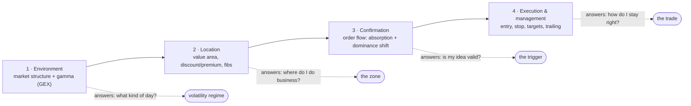

# The Robbins Cup Orderflow Strategy — Chris Creamer

Documentation of the trading process explained in the IQCapital interview
**"Trading WORLD CHAMPION Reveals the Orderflow Strategy That Won the Robbins Cup (Step-by-Step)"**
(https://www.youtube.com/watch?v=PL7LKUsCgIQ, ~58 min).

Chris Creamer won the Robbins World Cup **micro day-trading championship** with a
**100% return in the month of July**, at age 26. In the interview he walks through the
exact process on a whiteboard: what he checks before the open, where he is willing to
trade, how order flow confirms the entry, and how he manages the trade and himself.

> ⚠️ These notes are reconstructed from the video's auto-generated transcript.
> Nothing here is financial advice — it documents *his* discretionary process,
> which he applies to MNQ (Micro Nasdaq futures), not a mechanical system you can
> copy blindly. He stresses repeatedly that entries are "the final 5–10%".

## The process at a glance

Four steps, all prepared **before** the market opens, executed in the first ~90
minutes of the New York session:

His one-sentence summary of the whole approach: watch **effort versus result** —
who is trying to move price, are they being rewarded for it, and if not, who is
trapped and about to be forced out.

## Chapters

| File | Covers |
|---|---|
| [01-environment.md](01-environment.md) | Higher-timeframe structure, gamma exposure (GEX), positive vs negative gamma regimes |
| [02-location.md](02-location.md) | Value areas, discount vs premium, the Fibonacci zone (0.705 / 0.786 / 0.886), validity rules |
| [03-confirmation.md](03-confirmation.md) | Footprint candles, volume & delta profiles, absorption, the two-failure entry trigger |
| [04-trade-management.md](04-trade-management.md) | Stops, targets, trailing, the 1.5–2R / 60–65% win-rate profile, the 20k-contract volume filter |
| [05-process-discipline.md](05-process-discipline.md) | Rules with teeth, good vs bad losses, A/B/C-game sessions, tilt triggers and shutoffs |
| [06-crypto-bot.md](06-crypto-bot.md) | This strategy as a backtest + paper-trading bot for Bitvavo (`nl.debo.cryptodata.bot`) |

## Key facts from the interview

- **Instrument:** MNQ (Micro Nasdaq 100 futures); he reads MNQ order flow directly.
- **Timeframes:** 1h / 15m for context, 5m for execution (occasionally 1m).
- **Session:** first ~1.5 hours of New York open; sometimes Asia. Hard shutoff after that.
- **Tools mentioned:** Tanuki Trade (naive GEX), footprint/orderflow platforms (ATAS and others), volume profile.
- **Style:** selective mean-reversion-into-trend; 0–2 trades per day, most days.
- **Stated stats:** ~60–65% win rate, ~1.8 profit factor, typical realized 1.5–2R.
